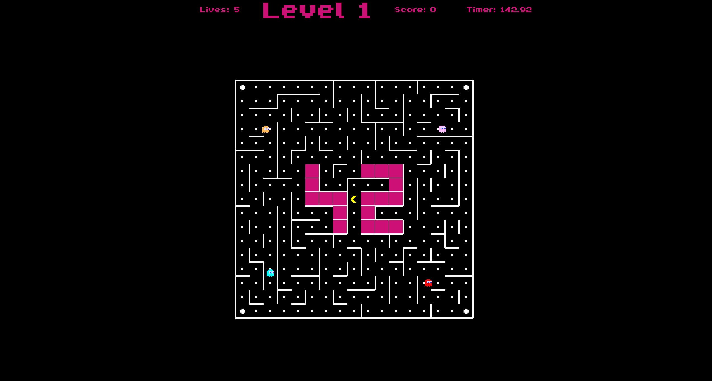

*This activity has been created as part of the 42 curriculum by brouzaud, pcaudron*

## Description:
This activity required us to handle every possible maze given to adapt it and create a pacman game based on it.

It required a main python file:
- pac-man.py

And a configuration file in json:
-   config.json

Furthermore a Makefile was required to run, clean or mypy and flake8 the project if necessary.

## Instructions:

Before trying to run the program we need to make sure we have all the dependencies.

To do that we need to use the Makefile and do:

- make install

If pygvideo does not work after the make install or if the make install fail because of it we need to downgrade or version of python to 3.13 and make a venv.

(Note: You may need to download python 3.13 if you don't have it)

- make venv

To enter the venv after it has been made:

- source Pac_venv/bin/activate

To exit the venv:

- deactivate

Inside the venv we need to make install again to have all the dependencies.

To launch the program we can use:
- python3 pac-man.py config.json

It shouldn't launch without the config.json
and it should be named config.json.

If the config.json is invalid the program will display the main menu and stop after trying to play a game, displaying a message in the terminal and removing the main menu.

Using the Makefile we can do:

- make run

or 

- make

To start the program

They are other useful Makefile commands like:

- make clean

and 

- make erase

To respectly clean the unecessary files and to erase the venv folder.

As required by the subject we need:

- make lint

- make lint-strict

To mypy and flake8

## Resources:

To better handle pygame, pygame-menu and pygvideo we used the docs of each of those packages as well as watched some videos.

We also used the help or our peers that already use pygame or pygame-menu

https://pygame-menu.readthedocs.io/en/latest/

https://www.pygame.org/docs/ref/pygame.html

https://pypi.org/project/pygvideo/

#### Ai usage:

AI was not used in this project

## Additional description:

### Configuration:

The configuration file is a .json as required by the subject.

| KEY | DESCRIPTION | EXAMPLE | LIMITS |
| --- | --- | --- | --- |
| Lives | Pacman lives | "lives":5 | No limits |
| highscore_filename | The name of the file storing the highscore | "highscore_filename":"highscore.json" | "Must be a json file |
| Seed | The seed of the maze | "seed":42 | No limits |
|Max time | The max time given per level | "lvl_max_time"90 | No limits |
| Level | Give the size of the maze for each of them | "level_1": {"width": 17, "height":17} | Must be a square and not higher than 25 and lower than 8 |
| Pac Points | Points given for pacgum | "pacgum_pts":25 | No limits
| Super pac points | Points for super pac gum | "super_pacgum_pts":100 | No limits
| Ghost points | Points when eating ghost | "ghost_pts: 200 | No limits |

You must have a dict for the size of each level from 1 to 10.

An example of how the config file should look like:

    {
        "highscore_filename":"highscore.json",
        "lives":5,
        "pacgum_pts":25,
        "super_pacgum_pts":100,
        "seed":42,
        "lvl_max_time":90,
        "ghost_pts": 200,
        "level_1": {"width": 17, "height": 17},
        "level_2": {"width": 12, "height": 12},
        "level_3": {"width": 15, "height": 15},
        "level_4": {"width": 17, "height": 17},
        "level_5": {"width": 14, "height": 14},
        "level_6": {"width": 13, "height": 13},
        "level_7": {"width": 11, "height": 11},
        "level_8": {"width": 11, "height": 11},
        "level_9": {"width": 16, "height": 16},
        "level_10": {"width": 25, "height": 25}
    }

### Highscore:

Since we learned how to use a .json file and since it's also a commun method used to store data in games. We decided to use another .json file.

The name is given in the config file.

If the file doesn't exist on the first game, it creates itself. Else it just add the new highscore to the file.

Here is what the file should look like:

    {
        "0": [
            27500,
            "Pakal"
        ],
        "1": [
            10400,
            "place "
        ],
        "2": [
            8650,
            "pascal"
        ],
        "3": [
            1475,
            ""
        ],
        "4": [
            25,
            "pdsaf "
        ],
        "5": [
            25,
            "fsaddfsd"
        ]
    }

We used a dict that keep the score and name of the player based on their ranking. But before that we have a list of name and score of each highscore and sort them by descending order. The index become the ranking and the key of the dict which makes it easier to access them later to display them.

### Maze generation:

We used the mazegenerator class to create a maze with the Perfect bool false to make it imperfect and pacman ready.

After that we adapt the maze to render it by accessing the bits of each cell to learn the directions of the walls and the accessible cells based on the position in the maze.

Using another A-Maze-ing package we adapt the hexadecimal output before doing the same things.

### Implementation:
    
### General software Architecture:

### Project Management:

